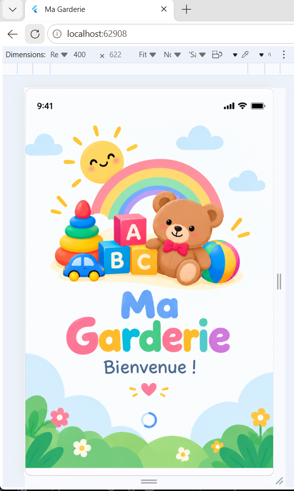
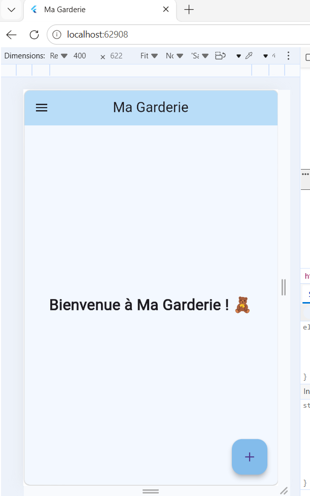
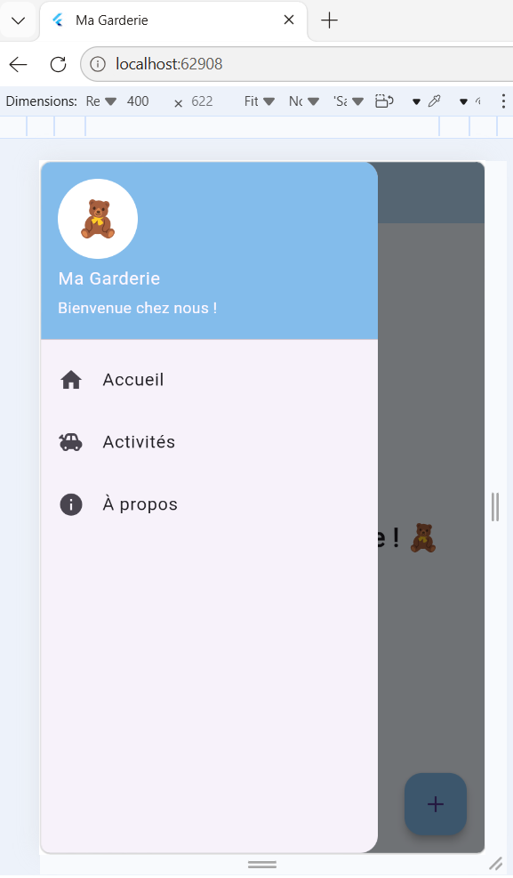
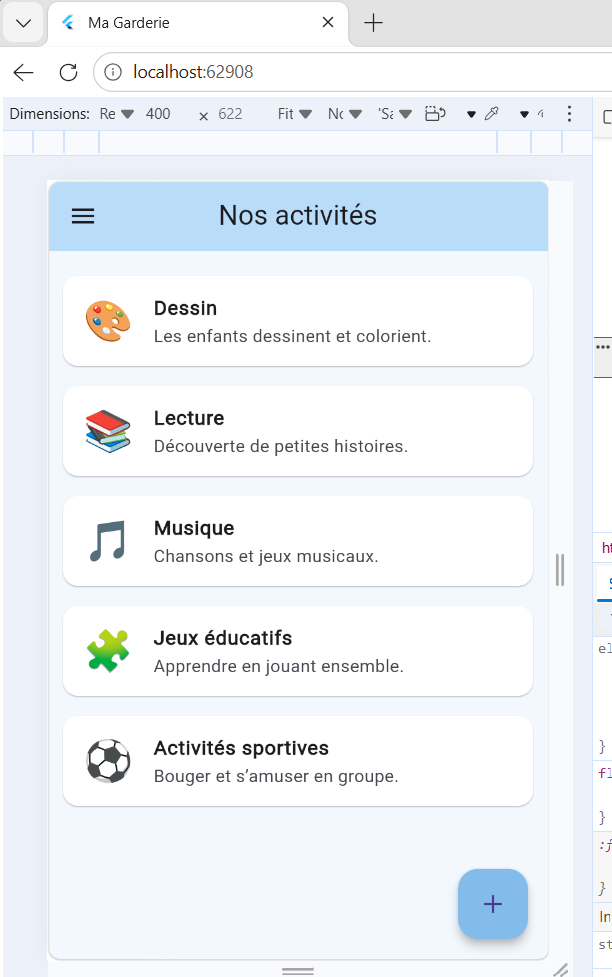

# Ma Garderie

## Présentation

Ma Garderie est une application mobile développée avec Flutter et Dart. Elle permet de découvrir une liste d'activités destinées aux enfants dans une interface simple et colorée.

## Fonctionnalités

- Splash Screen avec une illustration et une durée de 3 secondes.
- Page d'accueil.
- Menu Drawer avec Accueil, Activités et À propos.
- Liste statique de cinq activités.
- Affichage d'un SnackBar lors de la sélection d'une activité.
- Bouton flottant pour afficher le message « Nouvelle activité ».

## Technologies utilisées

- Flutter
- Dart
- Visual Studio Code
- Git et GitHub

## Installation

Cloner le projet :

```bash
git clone https://github.com/tayssier-aicha/garderie-mobile.git
cd garderie-mobile
```

Installer les dépendances :

```bash
flutter pub get
```

Lancer l'application :

```bash
flutter run
```

## Captures d'écran

Les captures d'écran de l'application seront ajoutées dans le dossier `screenshots/`.

### Splash Screen


### Page d'accueil


### Menu


### Liste des activités


